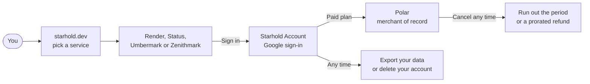

<div align="center">


# Starhold

**Privacy-first services, hosted and run for you.**

Four tools for builders, sysadmins and teams. Each one says what it does, what it costs, and whether you can use it today.

[](https://github.com/Quadstronaut/Starhold/commits/master)
[](https://github.com/Quadstronaut/Starhold)
[](https://github.com/Quadstronaut/Starhold)
[](https://svelte.dev)
[](https://starlight.astro.build)
[](https://www.typescriptlang.org)
[](https://polar.sh)

[](#services)
[](#account)
[](#billing)
[](#privacy)
[](#repo)
[](#contact)

**[starhold.dev](https://starhold.dev)** · **[Docs](https://starhold.fyi)** · **[Hangar](https://starhold.app)** · **[Fleet status](https://status.starhold.fyi)**

</div>

---

> [!NOTE]
> **Open since 2026-11-14.** Sign-in and paid checkout are open on Render, Status, Umbermark and Zenithmark. Free tiers cost nothing.

<a id="glance"></a>

## 🗺️ At a glance

| | Service | What it is | Free | Paid |
|---|---|---|---|---|
| 🖼️ | [**Render**](https://render.starhold.app) | An API that turns a page or HTML into an OG image, a PDF or a screenshot | 50 renders a month, watermarked | $5, $19 or $49 a month |
| 📟 | [**Status**](https://status.starhold.app) | Status pages for MSPs: public, password-protected or white-label | 1 public page | $15 or $29 a month |
| 🛡️ | [**Umbermark**](https://umbermark.starhold.app) | A scored hardening report for a Linux server, with a link you can share | Scans | $5 report; $9, $19 or $49 a month |
| ✉️ | [**Zenithmark**](https://zenithmark.starhold.app) | A mail and DNS scorecard for a domain, with daily monitoring as a paid plan | Scorecard | $9 or $29 a month |

Prices are in US dollars. The pricing page of each service is the authority; the tables below were copied from them on 2026-11-14.



<a id="services"></a>

## 🛰️ The services

<a id="render"></a>

### 🖼️ Render

An API for OG images, PDFs and screenshots. Send a `POST` with an API key from your dashboard; the file comes back as the response body. Renders stop at your allowance: no overage bill and no automatic upgrade.

| Plan | Price | Renders a month | Renders a minute | Watermark |
|---|---|---|---|---|
| Free | $0 | 50 | 10 | Yes |
| Hobby | $5 a month | 1,000 | 20 | No |
| Pro | $19 a month | 10,000 | 60 | No |
| Scale | $49 a month | 50,000 | 120 | No |

[Site](https://render.starhold.app) · [Pricing](https://render.starhold.app/pricing) · [API docs](https://render.starhold.app/docs)

<a id="status"></a>

### 📟 Status

Status pages with components, incidents, scheduled maintenance and monitors, plus RSS, Atom, a JSON endpoint and a badge on every plan. Visitors can subscribe by email.

| Plan | Price | Pages | Who can view | Monitors | Email subscribers per page | Emails a month |
|---|---|---|---|---|---|---|
| Free | $0 | 1 | Public | 5 | 50 | 100 |
| Private | $15 a month | 1 | Public, password or named viewers | 20 | 1,000 | 5,000 |
| MSP | $29 a month | 5 | Public, password or named viewers | 50 | 1,000 | 15,000 |

[Site](https://status.starhold.app) · [Pricing](https://status.starhold.app/pricing) · [Docs](https://status.starhold.app/docs)

<a id="umbermark"></a>

### 🛡️ Umbermark

Scan a Linux server, get a score and a report that explains each finding. A free scan needs no account.

| Plan | Price | What you get |
|---|---|---|
| Free scan | $0 | Anonymous scan, HTML report, shareable link for 30 days |
| Report | $5 one-off | One report kept 3 months, PDF download, every fix step |
| Solo | $9 a month | Up to 7 saved servers, re-scans weekly at most |
| Pro | $19 a month | Up to 15 saved servers, re-scans daily at most |
| Agency | $49 a month | Up to 50 saved servers, re-scans daily at most |
| Enterprise | By email | More than 50 servers: write to hello@starhold.dev |

[Site](https://umbermark.starhold.app) · [Pricing](https://umbermark.starhold.app/pricing)

<a id="zenithmark"></a>

### ✉️ Zenithmark

Enter a domain and get a report on SPF, DKIM, DMARC, MX, MTA-STS, TLS, DNSSEC, CAA and BIMI. The scorecard is free and needs no account. A paid plan re-checks your domain every day, emails you when something changes, and collects your DMARC aggregate reports.

| Plan | Price | Monitored domains |
|---|---|---|
| Scorecard | $0 | No account needed |
| Monitor | $9 a month | 1 |
| Monitor 5 | $29 a month | 5 |

[Site](https://zenithmark.starhold.app) · [Plans](https://zenithmark.starhold.app/plans)

<details>
<summary><b>Also on the shelf</b></summary>

| | State |
|---|---|
| [**Shush**](https://shushgame.com) | The quiet game on Discord: a new word is banned each day. Open, free, nothing to buy. |
| **Starbot** | A Discord assistant for the Starhold community. In development. |
| [**QNix**](https://starhold.dev/qnix) | Personal hosting. In development; interest form only. |

</details>

<a id="account"></a>

## 🔑 Starhold Account

One sign-in for every service, at [starship.starhold.app](https://starship.starhold.app).

- **Google sign-in, no separate password.** By default Starhold asks Google for an identifier and nothing else: no email, no name, no picture. Sharing your email address is optional.
- **Export.** Download what Starhold holds on you.
- **Delete.** Delete your account yourself. You choose now or at the end of the paid period, and every delete asks you to confirm first.

<a id="billing"></a>

## 💳 Billing

- Paid plans are sold through [Polar](https://polar.sh), the merchant of record. Polar handles the payment and the sales tax.
- **Cancel any time.** Run out the period you paid for, or take a prorated refund now. There are no cancellation fees.
- **The $5 Umbermark report** is refunded in full if it fails or is not what we described and you ask within 14 days.
- On Render and Status, hitting a limit stops the action: nothing upgrades without your click, and nothing is billed beyond your plan.
- Local consumer rights still apply. The full text: [refund policy](https://starhold.dev/legal/refunds) and [terms](https://starhold.dev/legal/terms).

<a id="privacy"></a>

## 🔒 Privacy

- **No third-party trackers.** No cookie banner on the Starhold sites, because they set no cookies.
- **We never sell data.**
- **We keep only what each service needs,** for a stated period, then delete it.
- **Export and delete are self-serve** in your Starhold Account.

The [privacy policy](https://starhold.dev/legal/privacy) has the details, and each product has its own notice for what it adds.

> [!IMPORTANT]
> **Not built yet, and we say so:** notification controls you can switch off, offline tiers that run on your own machine, and one public price table.

<a id="status-docs"></a>

## 📡 Status, docs and community

| | |
|---|---|
| 📡 **Fleet status** | [status.starhold.fyi](https://status.starhold.fyi): whether each service is up right now |
| 📚 **Docs** | [starhold.fyi](https://starhold.fyi): how each service works, what it supports today, where its limits are, and a dated build log |
| 🚀 **Hangar** | [starhold.app](https://starhold.app): every service on one page |
| 💬 **Discord** | [discord.gg/Ug8CM86Bxv](https://discord.gg/Ug8CM86Bxv): a place to hang out and ask questions |

<a id="backing"></a>

### ☕ Backing the work

[Patreon](https://www.patreon.com/cw/Quadstronaut) is support for the work. It is **not a purchase**: it buys no product access, no discounts and no special support, and it is not tax-deductible. The only thank-you is a role in the Starhold Discord named after your tier.

| Ping | Pulse | Beacon | Relay | Array | Observatory |
|---|---|---|---|---|---|
| $1 | $3 | $5 | $10 | $25 | $50 |

<sub>Per month.</sub>

<a id="repo"></a>

## 📦 What is in this repo

The source of the public Starhold websites. The four products live in their own repositories and are not here.

| Path | Site | Built with | What it is |
|---|---|---|---|
| [`apps/storefront`](apps/storefront) | [starhold.dev](https://starhold.dev) | SvelteKit, TypeScript | The storefront: services, principles, contact form, terms, privacy and refund pages |
| [`apps/docs`](apps/docs) | [starhold.fyi](https://starhold.fyi) | Astro Starlight | The docs and the build log |
| [`apps/hangar`](apps/hangar) | [starhold.app](https://starhold.app) | Static HTML and CSS | The launcher page |
| [`apps/status`](apps/status) | [status.starhold.fyi](https://status.starhold.fyi) | Static HTML and CSS | The page shell of the fleet status site |

```sh
# storefront
cd apps/storefront && npm ci && npm run dev

# docs
cd apps/docs && npm ci && npm run dev
```

> [!NOTE]
> This repository is generated. A bot copies `apps/` and this README here from a private source repository on every change, so a pull request opened here would be overwritten by the next sync. To report a problem, write to hello@starhold.dev.

<a id="contact"></a>

## ✉️ Contact

**[hello@starhold.dev](mailto:hello@starhold.dev)** or the [contact form](https://starhold.dev/contact). Starhold is one person in Arizona; whoever answers your message also runs the servers.

---

<div align="center">

<sub>Starhold · <a href="https://starhold.dev">starhold.dev</a> · <a href="https://starhold.fyi">starhold.fyi</a> · <a href="https://starhold.app">starhold.app</a> · <a href="https://status.starhold.fyi">status</a></sub>

</div>
