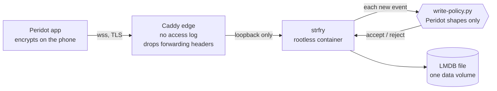

<div align="center">

# 💎 Starhold Peridot relay

**A Nostr relay run by Starhold for the Peridot app, at `wss://relay.starhold.app`. It stores only Peridot circle events, which the app encrypts on the phone before sending, and it never learns a client's IP address.**


</div>

> [!NOTE]
> This folder is the exact configuration the relay runs: the image is built from these files at a given git revision,
> and nothing is edited on the server. Nobody outside can prove that a server runs a given config; what anyone *can*
> check is that the app encrypts circle data before it leaves the phone.

> [!IMPORTANT]
> The Peridot app does not use this relay yet. It is added to the app's relay list in a later app update, next to
> independent public relays, so the app keeps working when this relay is down.

## 🧭 How a message travels



## ✅ What it accepts

Only the event shapes the Peridot app sends. Everything else is rejected, so this is not a general public relay.

| Kind | What it is in Peridot | Must carry |
|---|---|---|
| `30078` | cycle entries, heartbeats, the Delete-all-data marker, the relay probe | a `d` tag starting `peridot:` |
| `30078` | a problem report to Starhold | a `p` tag equal to Starhold's report key |
| `30402` | approval votes, invite accepts | an `h` (circle) tag |
| `30403` | member lists | an `h` tag |
| `30404` | join requests | an `h` tag |
| `30405` | approval requests | an `h` tag |
| `30406` | leave notices | an `h` tag |
| `1059` | delivery of a circle key to one member | a `p` and an `h` tag |
| `5` | deletion requests | only `a` / `e` / `k` tags, naming Peridot kinds and the author's own events |
| `27078` | the app's "Test relay" message (not kept: strfry drops it after 5 minutes) | `t` = `peridot-probe` |

| Limit | Value | Why |
|---|---|---|
| Event size | 32 KiB | the largest real Peridot event, a problem report at its caps, is about 22 KB |
| Tags per event | 128 | a Delete-all-data request carries up to 102 |
| Per public key | 10,000 at once, then 1 per second | the one-time upgrade re-sends every entry |
| Everyone together | 50,000 at once, then 100 per second | a ceiling for floods from fresh keys |
| Connections | about 4,000 at once | the container's open-file limit |
| Disk | 32 GiB | the database map size |

There are **no per-IP limits**, because the relay never sees an IP address.

## 🔒 Privacy properties and how each is enforced

| Property | Enforced by |
|---|---|
| No access log for this host | The Caddy block ([`Caddyfile.relay`](Caddyfile.relay)) has no `log` directive and imports no log snippet, and the edge's global options keep access lines out of the default log |
| The relay never learns a client's IP | Caddy removes `X-Forwarded-For`, `X-Forwarded-Host`, `X-Forwarded-Proto`, `X-Real-IP` and `Forwarded`, and strfry's `realIpHeader` is empty, so strfry only ever sees the server's own address. Also removed before the relay: `User-Agent`, `Referer`, `Cookie`, `Authorization` |
| No sign-in needed to read anything | NIP-42 is off; key deliveries (kind 1059) are readable by the recipient's key without signing in |
| Nothing is dumped | strfry's message dumps (`dumpInAll`, `dumpInEvents`, `dumpInReqs`) are off |
| Unknown or broken input is refused | The write policy fails closed: a crash, a wrong answer or no answer within 3 seconds makes strfry reject the event (tested) |
| Least privilege | Its own unprivileged service user, rootless podman, non-root user inside the container, read-only root filesystem, every Linux capability dropped, no new privileges, memory, CPU and process limits, listening on the server's loopback address only |

### 📝 What strfry still writes to its log

strfry has no switch for these lines. They hold **no client IP** (verified), and the server keeps its logs for 30 days.

- `Connect from <the server's own address>` and `Disconnect`, with a connection number.
- `Inserted event. id=<event id>` for each stored event, and `write policy blocked event <id>: <reason>` for each rejected one.
- `HTTP request for [<path>]` for plain HTTP requests, such as the relay information document.
- Only if the write policy itself fails: one error line that includes the submitted event (its public key, tags and still-encrypted content).

## 🗃️ Retention

Events are kept until their author replaces them (a newer event with the same `d` tag) or deletes them (a kind 5
deletion request, which Peridot's Delete all data sends). An event that carries a NIP-40 `expiration` tag, as problem
reports do, is removed when it expires. There is no age limit yet: how long the relay keeps events is an open decision.

## 📁 Files

| File | What |
|---|---|
| [`Containerfile`](Containerfile) | builds strfry from its pinned source tag (`1.1.3`, commit `16c00df`) on a digest-pinned Alpine base |
| [`strfry.conf`](strfry.conf) | the relay config; each value that differs from strfry's default says why |
| [`write-policy.py`](write-policy.py) | the write policy (strfry plugin) |
| [`peridot-relay.container`](peridot-relay.container) | the systemd quadlet that runs the container |
| [`Caddyfile.relay`](Caddyfile.relay) | the edge block for `relay.starhold.app` |
| [`tests/`](tests) | tests for the write policy, built from the app's real event shapes |

## 🧪 Test

```sh
python -m pytest apps/peridot-relay/tests -q
```

## 📜 Licence

strfry is © its authors and licensed under the GNU GPL v3 ([hoytech/strfry](https://github.com/hoytech/strfry)). This image builds it unmodified from source.
